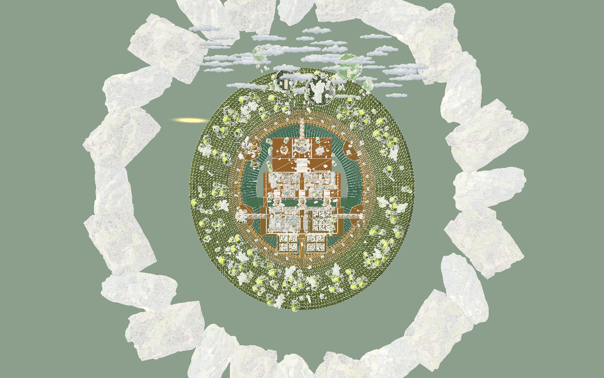

# 逐玉记 · JADE HUNTER

> 一款以良渚文化为背景的 3D 开放世界叙事游戏。你是良渚之王，在洪水降临前疏通水渠、组织生产、 Gather 玉石，携玉登台完成祭祀；亦可亲率武士讨伐盘踞荒原的岩石巨怪。

<p align="center">
  
</p>

---

## 目录

- [游戏简介](#游戏简介)
- [玩法与操作](#玩法与操作)
- [快速开始](#快速开始)
- [项目结构](#项目结构)
- [开发与源码](#开发与源码)
- [技术栈](#技术栈)
- [许可与素材](#许可与素材)

---

## 游戏简介

《逐玉记》以新石器时代晚期的良渚文明为舞台，构建了一座被水环绕的王城：中心城郭、环形水系、环稻田聚落、北部莫角山高地与云岸浮岛。玩家以第三人称自由漫游，在数日的时间推进中与先民对话、布置生产、应对洪水，并在终局完成玉琮祭祀。

**核心玩法**

- **叙事推进**：与长者、祭司、武士等角色对话，逐步解锁疏通水渠、备粮筑堤、拾玉祭祀的目标链
- **生存经营**：管理人口、粮食、材料、玉器，预测每次休整的产出与消耗
- **巨怪讨伐**：在西外环荒原找到岩石巨怪，按 E 开战，以「王」的身份指挥三名武士（冲锋 / 坚守 / 蓄势 / 撤退）作战
- **探索彩蛋**：观星石环触发夜色与北斗七星、祭坛玉琮的蓝色方圆光影、玉石共鸣、王城圈层地图、礼器技艺面板
- **静谧模式**：一键隐藏全部文字 UI，纯漫游欣赏场景

## 玩法与操作

| 按键 | 功能 |
|---|---|
| `W A S D` | 移动 |
| `Shift` | 疾跑 |
| `空格` | 跳跃 |
| `右键拖动 / 方向键` | 环视 |
| `滚轮` | 缩放镜头 |
| `E` | 互动 / 对话 / 讨伐巨怪 |
| `1`–`4` | 选择对话选项 |
| `M` | 王城圈层地图 |
| `K` | 礼器 · 技艺面板 |
| `H` | 隐藏 / 显示界面（静谧漫游） |
| `F` | 玉石共鸣特效 |
| `N` | 观星夜色 |
| `B` | 祭坛蓝色光影 |
| `F5` / `F9` | 保存 / 读取 |
| `R` | 重新开始 |
| `F12` | 截图 |
| `Esc` | 暂停 |

**讨伐岩石巨怪**：沿外环步道前往西侧荒原，找到直立的岩石巨怪，靠近后按 `E` 进入战斗。战斗时点击屏幕底部的指令（冲锋 / 坚守 / 蓄势 / 撤退），三名武士会实际跑向巨怪发起攻击。

## 快速开始

### 环境要求

- **操作系统**：Windows 10 / 11（字体与字体回退针对 Windows 设计）
- **Python**：3.8 – 3.12（64 位）
- **Panda3D**：1.10.x

### 安装

```bash
# 1. 创建虚拟环境（可选但推荐）
python -m venv .venv
.venv\Scripts\activate

# 2. 安装依赖
pip install -r requirements.txt
```

### 运行

```bash
python demo_v23ext.py
```

或**直接双击 `运行游戏.bat`**（会自动检测 Python 并启动）。

启动时先显示「逐玉记」主菜单，点击「启行新局」进入游戏；「读取玉契」可载入存档。

> **说明**：游戏依赖 Windows 系统自带字体（隶书 `SIMLI.TTF`、幼圆 `SIMYOU.TTF`、宋体 `simsun.ttc` 等）呈现古风 UI；在非 Windows 系统上会自动回退到 Panda3D 默认字体，观感略有差异但不影响运行。存档写入系统 `LOCALAPPDATA`，无需额外配置。

## 项目结构

```
逐玉记/
├── demo_v23ext.py        # ★ 最终入口：v0.23 扩展版（全部玩法集成）
├── main.py               # 基础游戏框架：世界、角色、相机、状态机、存档
├── battle_system.py      # 岩石巨怪讨伐战（回合指令 + 场景动画 + 打击特效）
├── hud_polish.py         # 静谧低干预 HUD + 纯漫游模式
├── jade_ui.py            # 王城圈层地图 / 礼器技艺面板
├── dialogue.py           # 对话引擎与剧情文本
├── menu_image.py         # 图片式主菜单与开场镜头
├── render_polish.py      # 风格化写实渲染（暖金主光 / 冷青补光 / 薄雾 / Bloom）
├── jade_icons.py         # 玉石 UI 图标生成
├── hud_ref_tex.py        # 参考图 HUD 贴图生成器（备用样式）
├── build_shrine.py       # 神殿 / 模型处理工具
├── demo_v02.py ... demo_v23.py   # 历代版本源码（完整开发迭代记录）
├── assets/               # 核心角色与场景资源
│   ├── frontier/         # 人物（王、长者、祭司、武士、村民）与建筑模型
│   ├── tripo/            # AI 生成的角色模型
│   ├── skyrite/          # 天空与地标
│   └── sounds/           # 音效
├── assets_new/           # 迭代新增资源
│   ├── *.bam             # Panda3D 模型（玉琮、玉环、神鹿、石柱、图腾怪…）
│   ├── rock_golem/       # 岩石巨怪 FBX 模型与贴图
│   └── ui/               # UI 图标与参考图
├── requirements.txt
├── 运行游戏.bat
└── docs/screenshot.png
```

## 开发与源码

本项目采用**渐进式版本迭代**开发：`demo_v02.py` 到 `demo_v23.py` 完整保留了从原型到成品的每一步演进，`demo_v23ext.py` 是集大成的最终版本。每一代源码都可独立运行（需对应资源），便于对照学习与追溯设计决策。

主要模块以 **Mixin** 方式混入最终类，职责清晰、可独立复用：

```
Sandlight23Ext(BattleMixin, HudPolishMixin, JadeUIMixin,
               RenderPolishMixin, ImageMenuMixin, DialogueUIMixin, PeopleDemo)
```

## 技术栈

- **引擎**：Panda3D（Python 绑定 + C++ 渲染核心）
- **图形**：程序化几何、BAM 模型、GLSL 着色、Bloom / 雾效后处理
- **模型资产**：Blender 建模导出 GLB → 转 BAM；Aholo AI 生成角色 FBX
- **UI**：OnscreenText / DirectGUI + PNMImage 程序化贴图
- **存档**：JSON（写入 `LOCALAPPDATA`）

## 许可与素材

游戏代码与场景为原创开发。第三方素材（如 AI 生成的角色模型）请按来源许可使用。项目中的字体依赖操作系统提供，未随仓库分发。

---

<p align="center">逐玉记 · 良渚之王</p>
